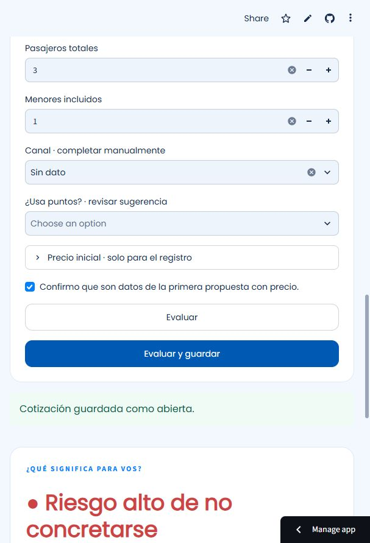

# QuoteScore
Proyecto personal en Python para explorar cotizaciones de viaje y su seguimiento.

**[Probar QuoteScore](https://quotescore-ecewfmkqdzuqi8xxzq9g5a.streamlit.app/)**

Subí un PDF de texto sin datos personales, revisá destino, fechas y pasajeros, y evaluá su riesgo relativo con regresión logística.
El modelo histórico es **experimental: no ofrece probabilidades validadas de venta**.
Los PDF se procesan en el servidor de Streamlit, en memoria; los registros duran solo la sesión y no reentrenan el modelo.
El modelo se configura de forma privada, fuera de GitHub. Sin esa configuración se muestra una demo sintética identificada como tal.

Python · Streamlit · scikit-learn · pypdf. [Instalación y funcionamiento](docs/public_demo.md).
